<!--
  GITHUB PROFILE README  |  repo: shubhamkx34/shubhamkx34

  SETUP
  1. Put this file at the repo root as README.md
  2. Put all nine SVG files into an assets folder in the same repo:
     whoami, divider, contact, pipeline, threadsync, threadsync-cicd, parsify, f90, vaultdrop

  FILL
  Search this file for FILL or YOUR_ to find every field you need to edit.
  Blocks wrapped in HTML comments are optional. Remove the comment markers to show them.
-->

<!-- ═════════════════════════  HEADER  ═════════════════════════ -->

 

<!-- OPTIONAL: remove the comment markers to add more

-->

<!-- ═════════════════════════  WHOAMI  ═════════════════════════ -->
## `~/whoami`

  

<!-- FILL (optional): remove the comment markers to show a status board under the terminal

 
<table align="center">
  <tr>
    <th align="center" width="280">🔭 Currently building</th>
    <th align="center" width="280">🌱 Currently learning</th>
    <th align="center" width="280">🤝 Looking for</th>
  </tr>
  <tr>
    <td align="center">FILL</td>
    <td align="center">FILL</td>
    <td align="center">FILL</td>
  </tr>
</table>

-->

<!-- ═════════════════════════  TECH STACK  ═════════════════════════ -->
## `~/stack`

<table>
  <tr>
    <td align="center" width="170"><b>Languages</b></td>
    <td>
      
      
    </td>
  </tr>
  <tr>
    <td align="center"><b>Frontend</b></td>
    <td>
      
      
    </td>
  </tr>
  <tr>
    <td align="center"><b>Backend &amp; Auth</b></td>
    <td>
      
      
      
      
    </td>
  </tr>
  <tr>
    <td align="center"><b>Databases</b></td>
    <td>
      
      
      
    </td>
  </tr>
  <tr>
    <td align="center"><b>AI &amp; Agentic</b></td>
    <td>
      
      
      
      
      
      
      
    </td>
  </tr>
  <tr>
    <td align="center"><b>Web Scraping</b></td>
    <td>
      
      
      
    </td>
  </tr>
  <tr>
    <td align="center"><b>DevOps &amp; Tools</b></td>
    <td></td>
  </tr>
</table>

<!-- ═════════════════════════  PROJECTS  ═════════════════════════ -->
## `~/projects`

<!-- ───────────── 1. THREADSYNC ───────────── -->
### `▸ threadsync-ai`

  

 

A stateful, tool-using AI assistant built with LangGraph. It keeps separate chat threads with durable memory, answers questions over uploaded PDFs with RAG, calls live tools for web search, stocks and weather, and pauses for human approval before a simulated order. Containerized with Docker and shipped to AWS EC2 through a GitHub Actions CI/CD pipeline.

`Python` `LangGraph` `LangChain` `Groq` `FAISS` `SQLite` `Tavily` `Streamlit` `Docker` `AWS EC2` `GitHub Actions` `LangSmith`

<!-- FILL: paste your live link -->

<b>How it is built</b> (click to expand)

 

| Decision | What it does |
|---|---|
| **Durable threads** | A LangGraph `StateGraph` with a SQLite checkpointer stores graph state in `threadsync.db` by thread ID. The sidebar starts new chats or restores saved ones. |
| **Tool routing** | `chat_node` (Groq `openai/gpt-oss-120b`) answers directly or calls a tool: Tavily web search, Alpha Vantage stock quotes, Weatherstack weather or the FAISS-backed `rag_tool`. Tool results go back to the LLM for the final answer. |
| **RAG over PDFs** | PDFs are loaded with PyPDF, split into overlapping chunks, embedded through OpenRouter (`nvidia/nemotron-3-embed-1b`) and indexed in a local FAISS store. Retrieval returns passages with source and page metadata. |
| **Human-in-the-loop** | `purchase_stock` calls LangGraph `interrupt()` to pause the run. Streamlit shows Approve and Decline controls, and the choice resumes the graph through `Command(resume=...)`. The order is simulated, so no real trades happen. |
| **Context management** | LangChain `trim_messages` keeps the history sent to the model inside a token budget. |
| **Streaming and tracing** | Replies stream into the chat with tool activity visible. Optional LangSmith tracing records runs and tool calls. |

**CI/CD pipeline**: every push to `main` runs the GitHub Actions workflow below.

  

 

| Stage | What happens |
|---|---|
| `integration` | Checks out the code and runs linting and unit test checks. |
| `push_to_registry` | Docker Buildx with GitHub Actions layer caching builds the `python:3.11-slim` image and pushes the `:main` and `:sha` tags to Docker Hub. |
| `continuous_deployment` | A self-hosted AWS EC2 runner pulls the image, injects secrets as environment variables, restarts the `stapp` container on port 8501 and checks the Streamlit `/_stcore/health` endpoint. |

 

<!-- ───────────── 2. MULTI-AGENT RESEARCH ───────────── -->
### `▸ multi-agent research system`

  

 

A team of four specialised LLM workers that turns a topic into a sourced report and then grades its own work. Search and Reader are tool-calling agents. Writer and Critic are LCEL chains, all running on Groq.

`Python` `LangChain` `Groq` `Tavily` `Trafilatura` `BeautifulSoup` `Streamlit`

<b>How it is built</b> (click to expand)

 

| Decision | What it does |
|---|---|
| **Hybrid research** | Top-5 search snippets give the Writer broad context. Only the top-2 articles are deep-scraped for evidence. This limits hallucination and keeps token use down. |
| **Relevance ranking** | Tavily results are sorted by score and direct PDF links are filtered out before anything is scraped. |
| **Scraper cascade** | Trafilatura first, then Readability with BeautifulSoup, then raw BeautifulSoup. Output is capped per page and timeouts and HTTP errors are handled. |
| **Agents vs chains** | `create_agent` with `web_search` and `scrape_url` tools for Search and Reader. Prompt, model and parser chains for Writer and Critic. |
| **Self-review** | The Critic returns a score out of 10, strengths, areas to improve and a one-line verdict. |
| **Interface** | Streamlit dashboard with live per-agent status cards, collapsible raw telemetry and a Markdown report download. |

 

<!-- ───────────── 3. PARSIFY ───────────── -->
### `▸ parsify`

  

 

A full-stack MERN platform that turns a resume, a self-description and a target job description into a structured interview-prep report: match score, technical and behavioral questions with model answers, skill-gap analysis with severity levels and a day-wise prep plan, exportable as a PDF.

`React` `Tailwind CSS` `Node.js` `Express` `MongoDB Atlas` `Groq` `Gemini` `Zod` `Puppeteer`

<!-- FILL: paste your live link -->

<b>How it is built</b> (click to expand)

 

| Decision | What it does |
|---|---|
| **Structured AI output** | Zod schemas validate and enforce the shape of every AI response before it is stored, so the report always has the fields the UI expects. |
| **Two AI providers** | Separate service modules call Groq (Llama models) and Google Gemini to generate the report. |
| **Rich report** | Match score, technical and behavioral questions with intentions and model answers, skill gaps with severity levels, and a day-wise preparation plan. |
| **Report management** | Create a report, fetch one by ID, or list all past reports. Rehydration logic rebuilds a saved report reliably for display. |
| **Custom auth** | Dedicated `User` and `Session` models with middleware-protected API routes, stored in a cloud-hosted MongoDB Atlas database. |
| **Frontend state** | React Context API and custom hooks, with a multi-step routing flow of Home, Feature, Processing and Report. |
| **PDF export** | An automated pipeline uses Puppeteer to turn the generated report into a downloadable, formatted PDF. |

 

<!-- ───────────── 4. F90 MOTION ───────────── -->
### `▸ f90-motion`

  

 

An interactive, scroll-driven web experience dedicated to the BMW M5 CS (F90). Fluid GSAP page transitions, scroll-mapped image sequences and a CDN-served video pipeline, responsive from 360px phones to 4K displays.

`React` `Vite` `Tailwind CSS` `GSAP` `ScrollTrigger` `React Router`

<!-- FILL: paste your live link -->

<b>How it is built</b> (click to expand)

 

| Decision | What it does |
|---|---|
| **Video pipeline** | Footage is compressed with HandBrake, pushed to a GitHub assets repo and served globally through the jsDelivr CDN, so the site needs no backend. |
| **Page transitions** | A full-screen GSAP overlay animates with `scaleY`, which is GPU-composited and avoids layout thrash. The new page fades in once the transition completes. |
| **Scroll animation** | ScrollTrigger drives image grids, text blocks and video pills as they enter the viewport. Frame-by-frame image sequences are mapped directly to scroll. |
| **Navigation** | A full-screen menu overlay with animated open and close. |
| **Brand details** | A hand-crafted F-90 SVG logo with a military stencil look, and a Track Records page with M5 CS performance data. |
| **Responsive by units** | Viewport units (`vw` and `vh`) keep layouts precise from 360px to 4K, and every page is mobile responsive. |

 

<!-- ───────────── 5. VAULTDROP ───────────── -->
### `▸ vaultdrop`

  

 

A full-stack cloud file-storage web app. Users register, log in, upload any file type, view their own files and download them through a server-side stream. Built to learn backend authentication, cloud storage and secure file handling.

`Node.js` `Express 5` `MongoDB` `Mongoose` `JWT` `bcrypt` `Multer` `Cloudinary` `EJS`

<!-- OPTIONAL: remove the comment markers if you deploy it

-->

<b>How it is built</b> (click to expand)

 

| Decision | What it does |
|---|---|
| **Validated sign-up and login** | express-validator checks the input on both routes. Passwords are hashed with bcrypt before they reach MongoDB. |
| **JWT sessions** | A successful login signs a JWT and stores it in a cookie. Auth middleware verifies it on every protected route and blocks anyone without a valid token. |
| **Direct-to-cloud uploads** | Multer with `multer-storage-cloudinary` streams files straight to Cloudinary, with the resource type set to auto so images, PDFs, videos and documents all work. |
| **Metadata in MongoDB** | The Cloudinary URL, original file name and owner ID are saved as a file document linked to the user. |
| **Per-user listing** | The home page queries only the logged-in user's files, so each account sees its own uploads. |
| **Forced downloads** | The server streams the file from Cloudinary and sets `Content-Disposition: attachment`, so the browser downloads it instead of opening it. |
| **Server-rendered views** | EJS templates for the register, login and home pages. |

<!-- ═════════════════════════  EXPERIENCE  ═════════════════════════ -->
## `~/experience`

<table>
  <tr>
    <td width="170" valign="top"><b>Embedded Software Intern</b> Emertxe · Bangalore, India Jun 2026 – Aug 2026</td>
    <td>
      <ul>
        <li>Built the core system architecture and control logic in <b>Embedded C</b> for a real-time Electric Vehicle dashboard, testing and simulating hex files in <b>PICSimLab</b>.</li>
        <li>Engineered event-driven algorithms for an <b>ADAS warning system</b> that processes continuous telemetry inputs and fires instantaneous software-driven safety alerts.</li>
      </ul>
    </td>
  </tr>
</table>

<!-- OPTIONAL SECTIONS: remove the comment markers and fill in whichever you want

## `~/achievements`
- FILL

## `~/writing`
- [FILL: post title](FILL: url)

## `~/currently-reading`
- FILL

-->

<!-- ═════════════════════════  CONTACT  ═════════════════════════ -->
## `~/contact`

 

<!-- FILL: replace YOUR_LINKEDIN_USERNAME -->

